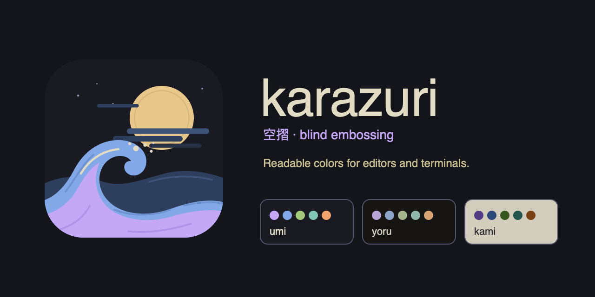

# karazuri palette



The source of truth for every karazuri port. All colors live in [`palette.json`](palette.json), and the ports are generated from it.

**[Preview and install karazuri](https://karazuri.github.io/palette/)**

Ink for the floating world. karazuri brings the same three palettes to editors, coding agents, and terminals.

## Variants

| Variant | Appearance | Background | Description |
|---|---|---|---|
| `umi` (sea) | dark | `#1A1A22` | The default dark variant: ink-blue background, warm text. |
| `yoru` (night) | dark | `#161514` | Darker and warmer, with less saturated colors. |
| `kami` (paper) | light | `#D2CCBC` | A light variant at about 60% brightness, between a dark and a light theme. |

### umi


### yoru


### kami


## How to use

Follow the installation instructions in the port repository for your editor, terminal, or CLI tool.

### Ports

| Port | Repo | Status |
|---|---|---|
| Neovim | [karazuri/nvim](https://github.com/karazuri/nvim) | Available |
| VS Code, Cursor, VSCodium | [karazuri/vscode](https://github.com/karazuri/vscode) | VSIX |
| Zed | [karazuri/zed](https://github.com/karazuri/zed) | Theme file or dev extension |
| T3 Code | [karazuri/t3code](https://github.com/karazuri/t3code) | Theme files |
| OpenCode, Codex CLI, Claude Code, Pi | [karazuri/extras](https://github.com/karazuri/extras#how-to-use) | Theme files |
| JetBrains IDEs | [karazuri/extras](https://github.com/karazuri/extras#jetbrains-ides) | Installable plugin |
| Ghostty, kitty, WezTerm, Alacritty, iTerm2, Windows Terminal, Helix, tmux, fzf, delta, bat, Sublime Text | [karazuri/extras](https://github.com/karazuri/extras#how-to-use) | Theme and config files |

### Building a new port

- `variants.<name>.colors` maps each role to a hex color. Every variant has the same roles.
- `roles` describes what each role is for, so a new port can map it to the right editor setting.
- `contrast.minimum` is the lowest WCAG contrast each text role may have against `bg`.
- `contrast.surface_minimum` sets minimums for pairs such as comments on a selection and text on diff lines.

Map each editor setting to a palette role, then read that role’s hex value from `variants.<name>.colors` for each variant. For example, map keyword highlighting to `keyword` so the same mapping works across all three variants.

## Scripts

Both scripts use only the Python standard library. The port build commands assume every repo is cloned side by side in one folder.

```sh
# Print contrast for every role against bg, the cursorline and the selection.
# Exits with status 1 if a declared foreground and background pair misses its minimum.
python3 scripts/check.py

# Generate a port's files. --out is the root of the port's repo.
python3 scripts/build.py nvim --out ../nvim
python3 scripts/build.py vscode --out ../vscode
python3 scripts/build.py zed --out ../zed
python3 scripts/build.py t3code --out ../t3code
python3 scripts/build.py extras --out ../extras

# Build the Astro homepage, SVG previews, and theme downloads for GitHub Pages.
npm ci
npm run build
```

Run `npm run dev` from this repository to preview the site at `/palette/`. The site build requires Python 3 and Node.js 22.23.4 or newer. Edit `src/pages/index.astro` for the homepage, `src/styles/site.css` for its design and motion, `src/scripts/sea.js` for the animated WebGL background, and `scripts/tool_catalog.py` for install instructions. GitHub Pages serves the generated `docs/` directory. When the VS Code themes change, refresh the PNG copies of the SVG previews in `../vscode/images/`, then rebuild the site's VSIX from the VS Code checkout.

```sh
cd ../vscode
npx @vscode/vsce package --out ../palette/docs/downloads/karazuri.vsix
```

## Changing a color

1. Edit `palette.json`.
2. Run `python3 scripts/check.py` and fix anything that fails.
3. Regenerate each port with `scripts/build.py` and commit the result in that port's repo.
4. Regenerate the previews and homepage with `npm run build`.

## Brand

`brand/` holds the logo and banner. The SVGs are the sources; the PNGs are rendered from them.

| File | Use |
|---|---|
| `mark.svg`, `mark.png` | Logo with rounded corners. The palette page uses it as its icon. |
| `avatar.svg`, `avatar.png` | Square logo for avatars, such as the GitHub org. |
| `banner.svg`, `banner.png` | 1280x640 banner for READMEs and repo social previews. |

## License

MIT
