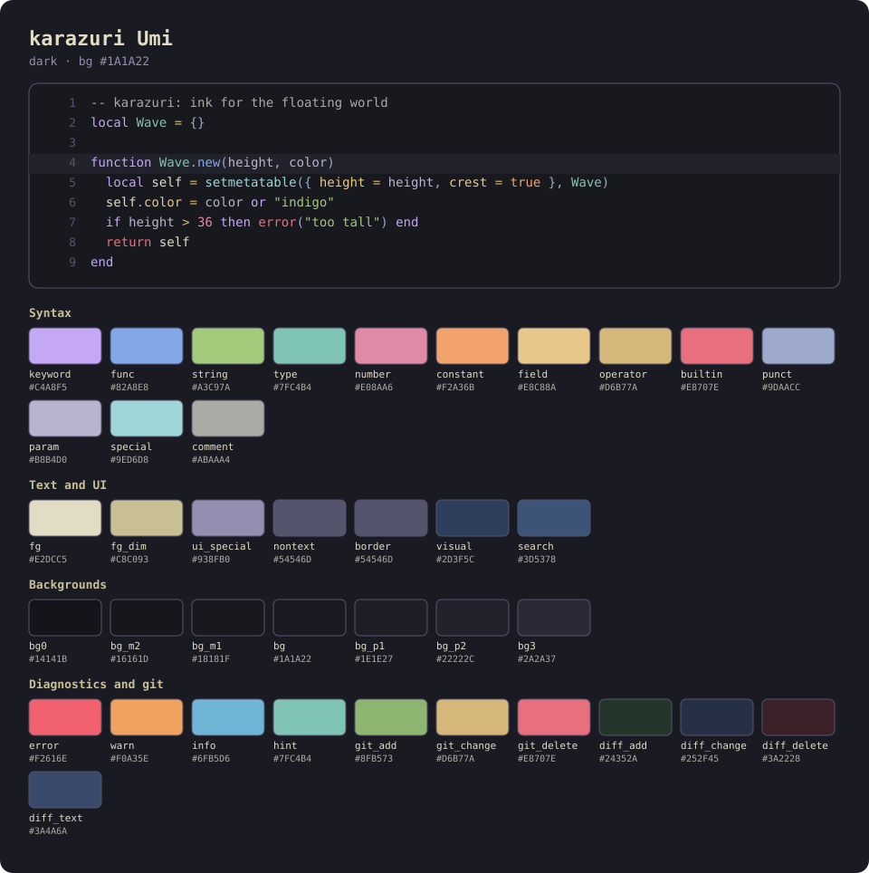
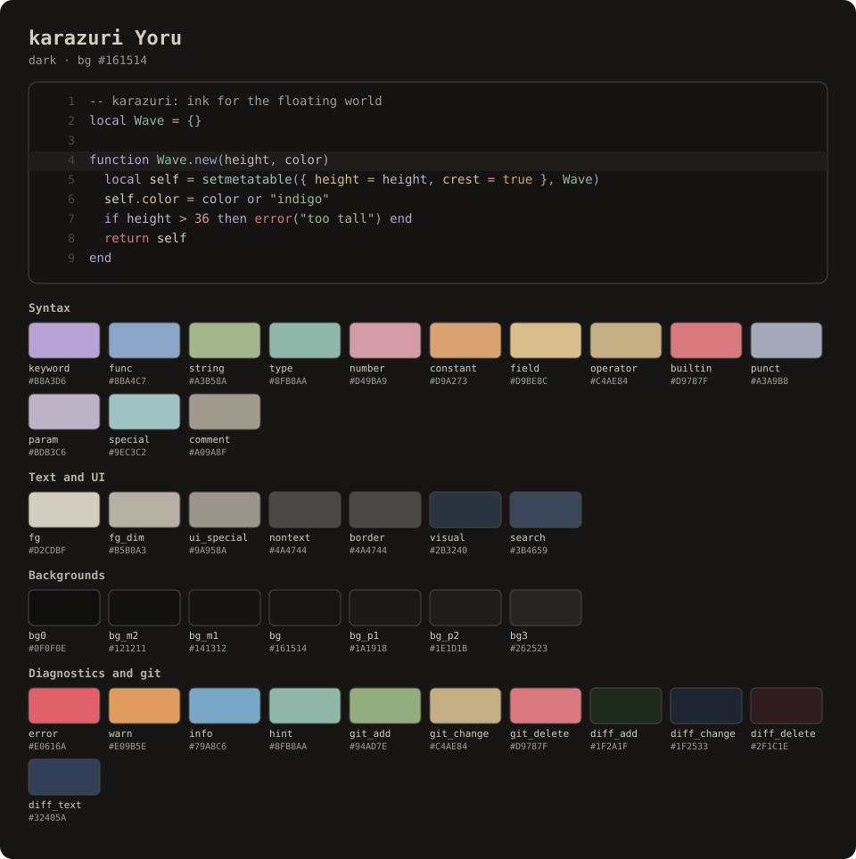
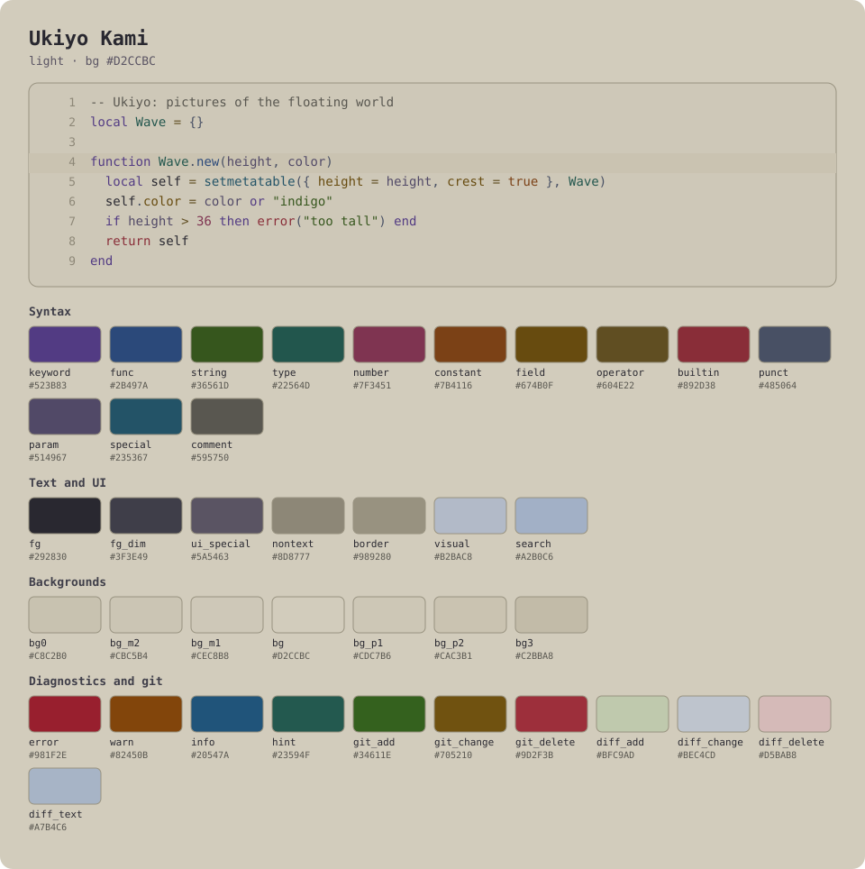

# Ukiyo palette

The source of truth for every Ukiyo port. All colors live in [`palette.json`](palette.json), and the ports are generated from it.

**[View the palette](https://ukiyo-theme.github.io/palette/)**

## Variants

| Variant | Appearance | Background | Description |
|---|---|---|---|
| `umi` (sea) | dark | `#1A1A22` | The default dark variant: ink-blue background, warm text. |
| `yoru` (night) | dark | `#161514` | Darker and warmer, with less saturated colors. |
| `kami` (paper) | light | `#D2CCBC` | A light variant at about 60% brightness, between a dark and a light theme. |

### umi



### yoru



### kami



## How to use

Follow the installation instructions in the port repository for your editor, terminal, or CLI tool.

### Ports

| Port | Repo | Status |
|---|---|---|
| Neovim | [ukiyo-theme/nvim](https://github.com/ukiyo-theme/nvim) | Available |
| VS Code | [ukiyo-theme/vscode](https://github.com/ukiyo-theme/vscode) | Install from source |
| Zed | [ukiyo-theme/zed](https://github.com/ukiyo-theme/zed) | Install from source |
| T3 Code | [ukiyo-theme/t3code](https://github.com/ukiyo-theme/t3code) | Install from source |
| Ghostty, kitty, WezTerm, Alacritty, iTerm2, Helix, tmux, fzf, delta, bat, Sublime Text | [ukiyo-theme/extras](https://github.com/ukiyo-theme/extras) | Install from source |

### Building a new port

- `variants.<name>.colors` maps each role to a hex color. Every variant has the same roles.
- `roles` describes what each role is for, so a new port can map it to the right editor setting.
- `contrast.minimum` is the lowest WCAG contrast each text role may have against `bg`.

Map each editor setting to a palette role, then read that role’s hex value from `variants.<name>.colors` for each variant. For example, map keyword highlighting to `keyword` so the same mapping works across all three variants.

## Scripts

Both scripts use only the Python standard library. The port build commands assume every repo is cloned side by side in one folder.

```sh
# Print contrast for every role against bg, the cursorline and the selection.
# Exits with status 1 if any role is below its minimum.
python3 scripts/check.py

# Generate a port's files. --out is the root of the port's repo.
python3 scripts/build.py nvim --out ../nvim
python3 scripts/build.py vscode --out ../vscode
python3 scripts/build.py zed --out ../zed
python3 scripts/build.py t3code --out ../t3code
python3 scripts/build.py extras --out ../extras

# Regenerate assets/*.svg and docs/index.html.
python3 scripts/build.py preview --out .
```

## Changing a color

1. Edit `palette.json`.
2. Run `python3 scripts/check.py` and fix anything that fails.
3. Regenerate each port with `scripts/build.py` and commit the result in that port's repo.
4. Regenerate the previews with `python3 scripts/build.py preview --out .`.

## License

MIT
